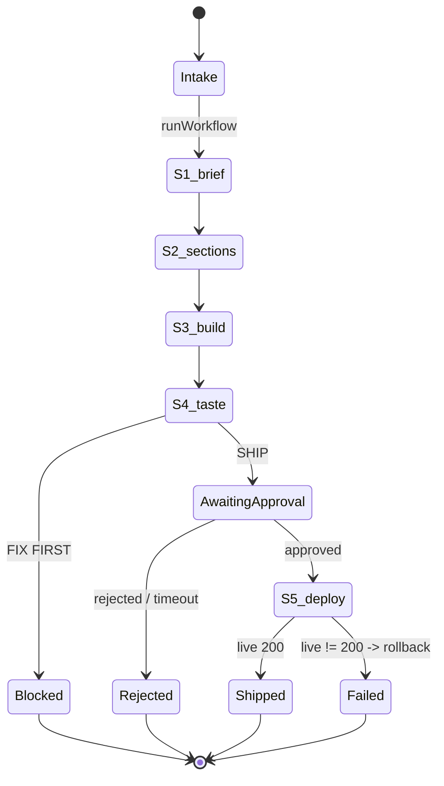

# Software Factory MVP — "request in, deployed app out"

Plan date: 2026-09-27 · Wedge: **Software Factory MVP** · Repo: **new `factory/`** · First proof build: **internal superbuild surface**

The promise this must deliver, or it is slop: **a business request goes in, a live URL comes out**, with a
human approval gate in the middle and a durable audit trail behind it.

---

## 0. Why this shape (grounded findings)

- The *design* already exists and is good: FORGE (`superbuild-agency/.claude/skills/forge-*`) has real stage
  contracts, hook gates (`brief-gate.py`, deploy-gate in `check.sh`), a writer→reviewer pattern, and a
  7-dim render-judge. **What it has no runtime for** is durability, a clock, and a front door — the
  `_orchestration/` bus has been dormant since June 2026 and nothing sweeps it.
- `superinterfaces/` is the factory's folder taxonomy with **every content dir empty**.
  `superbuild-dev/CONVERSATION_LOG.md` names the intended agentic package but ships none of it.
  `harness-lab/` is the versioning system for these assets — **its registry is empty**.
- The missing runtime is **already installed as skills on this machine**: `agents-sdk`
  (Cloudflare Agents SDK: DO state, `@callable` RPC, `schedule`, `AgentWorkflow`, `waitForEvent`,
  `useAgent`) and `sandbox-sdk`.
- **Verified this session:** Workflows is on the **Workers Free plan** (100k req/day shared, 10ms CPU/inv,
  1 GB-mo storage, 3,000 steps/day). Sandbox/Containers need **Docker locally + Workers Paid**, disk is
  ephemeral, and this machine is storage-constrained — so **the MVP does not use Containers**. No paid
  dependency anywhere.
- Their own guardrail (`AGENTS.md`): client code → paid ZDR models only; own work → free/stealth OK. The
  first build is **internal**, so the free path is legitimate. Client builds must be blocked from it in code.

---

## 1. Blueprint (flow-first — no code below this line means anything)

### 1.1 Flow map

```
[Browser / client]
  |
  |  submit brief {request, target, model_policy}
  v
[Worker fetch] --/agents/factory/<buildId>--> [FactoryAgent  (Durable Object)]
  |                                                    |  setState({status:'intake'})
  |                                                    |  runWorkflow(BuildWorkflow, {brief})
  |                                                    v
  |                                  [BuildWorkflow — durable steps, retried]
  |                                     S1 brief    request -> spec
  |                                     S2 sections spec -> section map
  |                                     S3 build    map -> files -> R2
  |                                     S4 taste    deterministic lint -> SHIP | FIX
  |                                     S5 deploy   waitForEvent('approval') -> Pages -> url
  |                                                    |  step.reportProgress / reportComplete
  |  <------ WebSocket: onWorkflowProgress / onStateUpdate ------+
  v
[React UI  useAgent()]   live stage rail · artifacts · approve/reject · live URL
```

### 1.2 IA tree

```
Factory
├── /                       New build
│   ├── request form        (textarea · deploy target · model policy · budget)
│   └── recent builds       (from DO storage / D1 later)
├── /build/:id              Build detail  ← the money screen
│   ├── stage rail          S1..S5, live status
│   ├── artifact viewer     spec · section map · generated files
│   ├── taste report        verdict + violations
│   ├── approval gate       APPROVE DEPLOY / REJECT
│   └── ship result         live URL · deploy log · rollback pointer
└── /ledger                 every build · cost · outcome (S5 measurement surface)
```

### 1.3 Wireframe — `/build/:id`

```
┌─ FACTORY ────────────────────────────────────────────────┬──────────────┐
│  new build   ·   builds   ·   ledger                      │  ● free tier │
├───────────────────────────────────────────────────────────┴──────────────┤
│  BUILD fct_2741   "landing page for superbuild"          policy: free      │
├──────────────────────────────────────────────────────────────────────────┤
│   S1 brief     ✓  12s   spec.md             [view]                        │
│   S2 sections  ✓   9s   section-map.md      [view]                        │
│   S3 build     ✓  41s   3 files             [view]                        │
│   S4 taste     ✓   1s   SHIP · 0 violations [view]                        │
│   S5 deploy    ◐  awaiting approval ───────────────────────────────┐      │
│                                                                     │      │
│   taste report:  SHIP   (deterministic lint · 0 violations)         │      │
│   preview:       https://fct-2741.pages.dev                         │      │
│                                                                     v      │
│                                       [ APPROVE DEPLOY ]   [ REJECT ]     │
├──────────────────────────────────────────────────────────────────────────┤
│   ship result: https://superbuild-landing.pages.dev    ✓ live   [open]    │
└──────────────────────────────────────────────────────────────────────────┘
   empty state:   "no builds yet — describe what you want shipped"  [new build]
   loading state: stage rail with the active row pulsing (◐)
   error state:   failed stage turns red with the raw step error inline
```

### 1.4 Decision tree

```
brief received
├─ request too vague (<5 beats / no outcome)? -> reject at S1, ask for more   (mirrors forge-brief)
├─ model_policy = free AND project is a client slug?
│     -> REFUSE (guardrail). force zdr-paid.
└─ proceed
   S1 -> S2 -> S3 -> S4
   S4 verdict
   ├─ FIX FIRST -> stop. write findings to ledger. do NOT deploy.
   └─ SHIP      -> wait for human approval
                   ├─ REJECTED  -> terminate, keep artifacts
                   ├─ timeout 7d -> terminate, keep artifacts
                   └─ APPROVED  -> S5 deploy
                                   ├─ upload fails   -> auto-retry x2, then fail loudly
                                   ├─ live check 200 -> mark shipped, capture URL
                                   └─ live check !=200 -> rollback, mark failed
```

### 1.5 Flow chart



### 1.6 Composition note

An **operator console, not a toy**. Dense, monospace-leaning, one accent colour for "live/active". The
**stage rail is the spine** — it is the first thing the eye lands on and it must be readable at a glance
from across a room. The approval gate is the only large, unmissable control on the page; everything else
is quiet. No dashboards-as-decoration: every number on screen is something the operator can act on.

### 1.7 Thinnest slice (what I am cutting)

| Cut | Why it is safe to cut now |
|---|---|
| Sandbox/Containers for the build step | needs Docker + Workers Paid; the model writes files directly |
| Visual render-judge (`taste-shot`) | deterministic lint is enough for SHIP/FIX at MVP; judge is harness S3+ |
| D1 cross-build ledger | DO storage covers the MVP; add D1 when `/ledger` needs queries |
| Multi-page / multi-route builds | one landing page end-to-end proves the whole flow |
| Auth | single `FACTORY_TOKEN` secret; real accounts later |
| Figma / Magic Patterns / multi-wave parallel agents | post-MVP; single-pass generation first |

---

## 2. Tech spec

**Stack:** Cloudflare Workers + **Agents SDK** (`agents`) · SQLite-backed Durable Objects · **Workflows**
(`AgentWorkflow`) · model calls over `fetch` (OpenRouter free for own work; paid ZDR for client) · R2 for
artifacts · **Cloudflare Pages Direct Upload API** for the deploy rail · React + Vite + `useAgent`.

**Why Pages for the deploy rail:** one authenticated multipart POST → a live URL; free; instant preview;
no container, no CI wait. Client apps that need Workers/D1 later move to the GitHub-Actions path already
proven in `aidept/.github/workflows/ci.yml` and `itfamily/fintrack`.

### 2.1 Bindings (`wrangler.jsonc`)

```jsonc
{
  "name": "factory",
  "main": "src/server/index.ts",
  "compatibility_date": "2025-01-28",
  "compatibility_flags": ["nodejs_compat"],
  "durable_objects": { "bindings": [{ "name": "FACTORY_AGENT", "class_name": "FactoryAgent" }] },
  "migrations": [{ "tag": "v1", "new_sqlite_classes": ["FactoryAgent"] }],
  "workflows": [{ "name": "build-workflow", "binding": "BUILD_WORKFLOW", "class_name": "BuildWorkflow" }],
  "r2_buckets": [{ "binding": "ARTIFACTS", "bucket_name": "factory-artifacts" }],
  "assets": { "directory": "./dist/client", "binding": "ASSETS", "not_found_handling": "single-page-application", "run_worker_first": true }
}
```

Secrets (never committed, set with `wrangler secret put`): `CF_API_TOKEN` (Pages:Edit), `CF_ACCOUNT_ID`,
`OPENROUTER_API_KEY`, `FACTORY_TOKEN`, `ZDR_MODEL`. Local dev via gitignored `.dev.vars`.

### 2.2 Agent state (the durable spine)

```ts
type StageId = "S1" | "S2" | "S3" | "S4" | "S5";
type StageStatus = "pending" | "running" | "done" | "failed" | "awaiting-approval";

type BuildState = {
  buildId: string;
  request: string;
  project: string;                       // "superbuild" | client slug
  modelPolicy: "free" | "zdr-paid";
  status: "intake" | "running" | "awaiting-approval" | "shipped" | "failed" | "rejected" | "blocked";
  stages: Record<StageId, { status: StageStatus; note?: string; ms?: number }>;
  artifacts: { spec?: string; sectionMap?: string; files?: string[]; tasteReport?: string };
  deploy: { url?: string; project?: string; rollback?: string; at?: number };
  error?: string;
};
```

`@callable()` methods on `FactoryAgent`: `startBuild(brief)`, `approve()`, `reject()`, `getBuild(id)`.
`onWorkflowProgress` / `onWorkflowComplete` / `onWorkflowError` broadcast to connected clients — that is
the live UI for free. `validateStateChange` rejects illegal transitions (e.g. shipping without approval).

### 2.3 Workflow steps

| step | durable work | retry |
|---|---|---|
| `s1-brief` | model → `spec.md`; validate ≥5 narrative beats + one primary outcome | 3 |
| `s2-sections` | model → `section-map.md` (blocks + order) | 3 |
| `s3-build` | model → files `{index.html, styles.css, app.js}` → put to R2 | 3 |
| `s4-taste` | **pure lint** (tokens, structure, headings, no hardcoded colours) → SHIP / FIX FIRST | 1 |
| `gate` | `step.waitForEvent("approval", { timeout: "7d" })` | — |
| `s5-deploy` | Pages direct upload → poll deployment → live URL → verify 200 | 2 |

`step.mergeAgentState` writes back stage status + artifact keys after each step, so the agent state is
always resumable and the UI is always truthful. FIX FIRST findings are logged to a local
`_orchestration/patch-ledger.md`-shaped file — this is how the factory feeds the same compounding loop FORGE uses.

### 2.4 Model policy (enforced in code, not convention)

```ts
const CLIENT_SLUGS = ["vanmossel", "itfamily", "denovolabs", "aidept", "xim"];
function resolveModel(project, policy) {
  if (CLIENT_SLUGS.includes(project) && policy === "free")
    throw new Error("Guardrail: client builds must use a paid ZDR-capable model.");
  return policy === "zdr-paid" ? env.ZDR_MODEL : FREE_MODEL;
}
```
This ports `AGENTS.md`'s rule from a note into an assertion — the same move that made the leak in
`~/.codex/config.toml` possible is prevented here.

---

## 3. Files to create

```
factory/
├── AGENTS.md                              # 10-line project memory (inventory rule)
├── README.md
├── package.json  tsconfig.json  vite.config.ts  wrangler.jsonc
├── .flow/0001-factory-mvp/BLUEPRINT.md    # this plan, landed (flow-first rule)
├── .github/workflows/deploy.yml           # npm test -> wrangler deploy
├── src/server/
│   ├── index.ts                           # fetch + routeAgentRequest + ASSETS fallback
│   ├── factory-agent.ts                   # FactoryAgent
│   ├── build-workflow.ts                  # BuildWorkflow (the 6 steps)
│   ├── models.ts                          # model policy + provider call
│   ├── pages-deploy.ts                    # Pages direct-upload + poll + verify
│   ├── lint.ts                            # pure deterministic taste lint
│   └── stages/{s1-brief,s2-sections,s3-build,s4-taste,s5-deploy}.ts
├── src/client/
│   ├── main.tsx  App.tsx
│   ├── routes/{new-build,build-detail,ledger}.tsx
│   └── components/{StageRail,ArtifactViewer,TasteReport,ApprovalGate}.tsx
└── test/{lint,models,pages-deploy}.test.ts   # vitest, pure functions only
```

**Reused, not rebuilt:** FORGE stage contracts (`forge-brief` validation, the SHIP/FIX-FIRST verdict, the
FIX→patch-ledger loop) are ported from `superbuild-agency/.claude/skills/forge-*`; the deploy+verify+
rollback pattern is ported from `itfamily/fintrack/.github/workflows/deploy-production.yml`.

---

## 4. Guardrails

1. **Client code never touches a free model** — `resolveModel` above refuses it.
2. **Secrets**: `wrangler secret put` only; `.dev.vars` gitignored; no token ever in a committed file.
3. **Budget**: free tier only — DOs, Workflows, R2, Pages. No Containers. Watch the Workflows free cap
   (3,000 steps/day): a full build is ~6 steps, so ~500 builds/day before any limit is felt.
4. **Deploy gate is a precondition, not a suggestion** — `s5-deploy` cannot run without a SHIP verdict and
   an approval event, enforced inside the workflow, mirroring FORGE's `deploy-gate` hook.
5. **Blueprint before code** — this document lands at `.flow/0001-factory-mvp/BLUEPRINT.md` first.

---

## 5. Verification

1. `npx wrangler dev` → open the local UI, submit a brief through the form.
2. Confirm the stage rail advances **S1→S4 live** over the WebSocket (no refresh).
3. Confirm S4 shows SHIP + violation count, and the approval gate blocks.
4. Approve → confirm S5 uploads to Pages, polls, and returns a URL.
5. `curl -sI <url>` returns **200**; `curl -s <url> | grep -i "<hero phrase>"` matches.
6. `npm test` — vitest green on `lint`, `models` (incl. the client-slug refusal), `pages-deploy` builder.
7. `npx wrangler deploy --dry-run` — bindings + syntax valid.
8. **Acceptance:** one internal superbuild landing page built end-to-end and live. Screenshot + URL recorded.
9. Record it: `harness-lab/software-factory/manifest.json` — stage **S2** at commit, **S4** once the live
   URL exists, with `measurement` = time saved vs. manual FORGE and the live URL as `evidence`.

---

## 6. Cashflow tie-in (why this is the right MVP)

- The **screen recording of one build going request → live URL** is the sales asset. It is the demo that
  sells both other wedges: the productized service ("we ship your page/app") and the harness packs.
- **Two parallel blockers** that gate actual cash, neither of which is code:
  1. **B1 — rotate the leaked tokens** in `~/.codex/config.toml` (+ the Coda bearer). Do this first; it is
     the only item with real downside. This plan's `CF_API_TOKEN` must be a *new* fine-grained token.
  2. **Payment rail** — there are **zero** commerce credentials on this machine (no Stripe/Gumroad/Shopify).
     `superbuild.shop` cannot take money today. Pick one and wire it; that is the shortest path from
     "working capability" to "cashflow".
- Then the sell motions, in order: (a) **productized service** on the existing itfamily/vanmossel network
  using this factory as the delivery engine; (b) the factory itself as a **public demo + thesis**
  (`/thesis`) — the OSS write-up, since the harness-economics and staging model name no clients and can go
  public even while the repo stays private.

## 7. Failure modes (each with its bouncer)

| Failure | Caught by | Result |
|---|---|---|
| Vague brief | `s1-brief` validation | reject, ask for more — never build it |
| Model returns broken files | `s4-taste` lint | FIX FIRST, no deploy |
| Client build on a free model | `resolveModel` | throws, build refused |
| Deploy without approval | `s5-deploy` precondition | step never runs |
| Live URL not 200 after deploy | `s5-deploy` verify | rollback, mark failed |
| Free-tier step cap hit | Workflows limit | build fails loudly, not silently |
